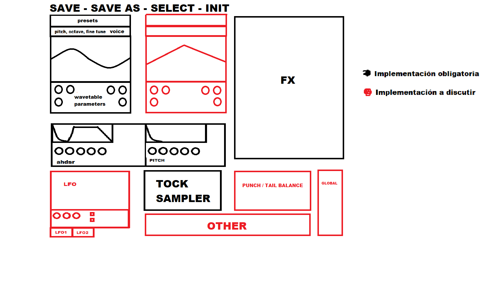

# UI Layout

- Status: v2, agreed with the product owner (2026-10-11). "Other" is reserved, contents to be defined.

This document describes the functional layout of the editor. Visual styling (colours, fonts, knob graphics) is a separate, later task and is not specified here.



In the original sketch, black areas were mandatory and red areas were to be discussed. The decisions on the red areas are recorded below.

## Principles

- Function first: every MVP feature is reachable from the main window without menus.
- Resizable with a fixed aspect ratio; all positions are relative to the window size.
- All styling goes through a custom `LookAndFeel`, so the visual redesign does not move components.
- Double-click any knob to reset it to default; Ctrl/Cmd-drag for fine adjustment.
- Each area is its own component (`fcm::ui::<Area>Panel`), so areas can be added, removed or moved without touching the others.

## Grid

```
┌──────────────────────────────────────────────────────────────────────┐
│ Preset bar: SAVE · SAVE AS · SELECT · INIT · preset name             │
├────────────────┬────────────────┬────────────────────────────────────┤
│ Oscillator 1   │ Oscillator 2   │                                    │
│  header        │  header        │                                    │
│  wavetable     │  wavetable     │             FX rack                │
│  display+knobs │  display+knobs │                                    │
├────────────────┼────────────────┤                                    │
│ Amp envelope   │ Pitch envelope │                                    │
├────────────────┼────────────────┼───────────────────┬────────────────┤
│ LFO 1/2        │ Tock           │ Punch/Tail balance│ Global         │
│ (after MVP,    ├────────────────┴───────────────────┤                │
│  space kept)   │ Other (reserved)                   │                │
└────────────────┴────────────────────────────────────┴────────────────┘
```

## Areas

| Area | Contents | MVP | Maps to |
|---|---|---|---|
| **Preset bar** | `SAVE` (overwrite current user preset), `SAVE AS`, `SELECT` (browser), `INIT` (reset to the default patch), current preset name with prev/next | Yes | Presets (ARCHITECTURE §5) |
| **Oscillator 1 and 2** | Two identical panels. Header: on/off, Pitch, Octave, Fine tune. Wavetable display (click to load, frame name). 6 knobs: Position, Level, Phase, plus three reserved for later oscillator features | Yes | Oscillators (§4.2) |
| **Amp envelope** | Editable display (drag, add, delete points) + 5 knobs: Attack, Hold, Decay, Sustain, Release. Knobs move the main points of the same curve. Shows the punch/tail split marker. Default shape: kick + bass | Yes | Envelopes (§4.4) |
| **Pitch envelope** | Editable display + 5 knobs: Amount (st), Attack, Decay, Curve, End | Yes | Envelopes (§4.4) |
| **Tock** | Mode switch (Synth / Sample), sample selector (factory list + load file), Level, Tune, Start, Decay, Tone | Yes | Tock (§4.3) |
| **Punch / Tail balance** | Balance knob (punch ↔ tail) and a Split slider for the time where the punch ends and the tail starts | Yes | Punch/Tail (§4.5) |
| **Global** | Output gain, safety limiter on/off, Quality (oversampling 1x/2x/4x/8x), Glide on + time, Velocity sensitivity, Key track | Yes | Voice (§4.1), Output (§4.7) |
| **FX rack** | Reorderable list of effect slots (drag handle, enable, mix) with the selected effect's panel below | Yes | FX chain (§4.6) |
| **LFO 1 / LFO 2** | Display, 3 knobs, 2 toggles, LFO1/LFO2 tabs (from the sketch) | After MVP. The space is kept empty so adding it does not move other panels | Requires a modulation system |
| **Other** | Reserved space | To be defined | |

## Standalone audition strip

Only in the Standalone, below the grid: Auto-play toggle, BPM and an on-screen keyboard. It is not part of the plugin layout and does not exist in VST3/AU. See [standalone-audition](specs/standalone-audition.md).

## Component tree

```
FrenchcoreEditor
├── PresetBar
├── OscillatorPanel ×2       (same class, bound to osc1 / osc2)
│   ├── OscillatorHeader
│   ├── WavetableDisplay
│   └── KnobRow (6)
├── EnvelopePanel (amp)      (same class for both envelopes)
├── EnvelopePanel (pitch)
├── TockPanel
├── PunchTailPanel
├── GlobalPanel
├── FxRackPanel
│   ├── FxSlotList (drag to reorder)
│   └── FxDetailPanel (selected effect, auto-generated or custom)
├── AuditionPanel            (Standalone only)
└── placeholders: LfoPanel (post-MVP), OtherPanel (reserved)
```

## Revision history

| Version | Date | Change |
|---|---|---|
| v1 | 2026-10-11 | First layout from the product owner's sketch. |
| v2 | 2026-10-11 | Red areas decided: two identical oscillators, punch/tail balance with split slider, global panel contents, LFOs after MVP, tock with synth and sample modes. |
